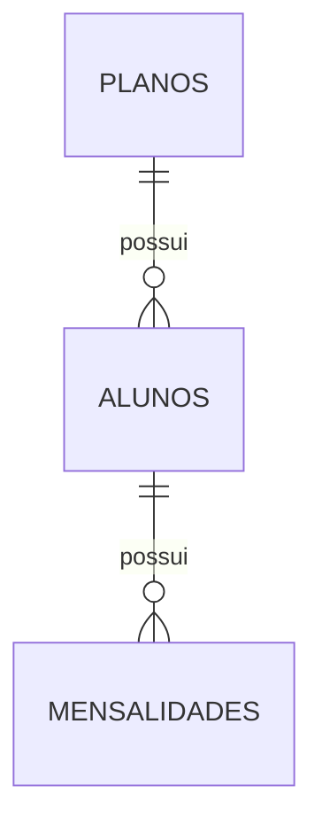

# Academia System — API REST

Alunos: Diogo Yudi e Eduardo Lopes

API de gestão de **planos, alunos e mensalidades de uma academia**, desenvolvida para a disciplina
Desenvolvimento Back-End, 4º período de Engenharia de Software, Campus SJP.

O sistema organiza os planos disponíveis, os alunos vinculados e o histórico das cobranças mensais.
Oferece CRUD das três entidades, regras de negócio, persistência em Supabase/PostgreSQL, testes
unitários e de integração e documentação interativa Swagger/OpenAPI.

## Sumário

1. [Equipe e tecnologias](#1-equipe-e-tecnologias)
2. [Entidades e relacionamentos](#2-entidades-e-relacionamentos)
3. [Regras de negócio](#3-regras-de-negócio)
4. [Arquitetura e estrutura](#4-arquitetura-e-estrutura)
5. [Configuração e execução](#5-configuração-e-execução)
6. [Banco de dados](#6-banco-de-dados)
7. [Endpoints e respostas](#7-endpoints-e-respostas)
8. [Exemplos de requisições](#8-exemplos-de-requisições)
9. [Swagger](#9-swagger)
10. [Testes e cobertura](#10-testes-e-cobertura)

## 1. Equipe e tecnologias

| Integrante |
| --- |
| Eduardo Lopes |
| Diogo Yudi |

| Tecnologia | Uso |
| --- | --- |
| Node.js 22+ e TypeScript | Execução, tipagem e compilação |
| Express 5 | Rotas, JSON e tratamento de erros |
| Supabase / PostgreSQL | Persistência, UUIDs e integridade referencial |
| @supabase/supabase-js | Cliente de acesso à Data API |
| Vitest e @vitest/coverage-v8 | Testes e medição de cobertura |
| Supertest | Requisições HTTP nos testes de integração |
| Docker Compose e PostgREST | Banco e Data API locais descartáveis para testes |
| swagger-ui-express / OpenAPI 3.0.3 | Documentação interativa |
| @apidevtools/swagger-parser | Validação automatizada do contrato OpenAPI |
| tsx | Execução TypeScript em desenvolvimento |
| Git | Histórico e branches de evolução |

## 2. Entidades e relacionamentos



Cada aluno pertence a um plano, e cada mensalidade pertence a um aluno. As três entidades usam UUID
gerado pelo banco com `gen_random_uuid()`. `created_at` usa `now()` como valor padrão.

### Plano — tabela `planos`

| Atributo | Tipo SQL | Configuração / finalidade |
| --- | --- | --- |
| `id` | uuid | PK, gerado automaticamente |
| `nome`, `descricao`, `icon` | text | Obrigatórios; nome, descrição e ícone do plano |
| `ordem_exibicao` | int4 | Obrigatório, padrão 0; ordenação da listagem |
| `valor_mensal` | numeric | Obrigatório, padrão 0; preço do plano |
| `duracao_meses` | int4 | Obrigatório, padrão 1 |
| `ativo` | bool | Obrigatório, padrão true |
| `created_at` | timestamptz | Padrão now(), aceita null no schema |

### Aluno — tabela `alunos`

| Atributo | Tipo SQL | Configuração / finalidade |
| --- | --- | --- |
| `id` | uuid | PK, gerado automaticamente |
| `planoId` | uuid | Obrigatório, FK para `planos.id` |
| `nome`, `descricao`, `email`, `telefone` | text | Obrigatórios |
| `data_nascimento` | date | Obrigatória |
| `valor_mensalidade` | numeric | Obrigatório, padrão 0; valor negociado com o aluno |
| `ativo` | bool | Obrigatório, padrão true |
| `created_at` | timestamptz | Padrão now(), aceita null no schema |

### Mensalidade — tabela `mensalidades`

| Atributo | Tipo SQL | Configuração / finalidade |
| --- | --- | --- |
| `id` | uuid | PK, gerado automaticamente |
| `alunoId` | uuid | Obrigatório, FK para `alunos.id` |
| `competencia` | date | Obrigatória; primeiro dia do mês cobrado |
| `valor` | numeric(10,2) | Obrigatório; valor histórico da cobrança |
| `data_vencimento` | date | Obrigatória |
| `data_pagamento` | date | Aceita null; obrigatória quando paga |
| `status` | text | Obrigatório, padrão pendente; pendente, paga ou cancelada |
| `created_at` | timestamptz | Obrigatório, padrão now() |

`competencia: "2026-11-01"` representa novembro de 2026, independentemente do dia de vencimento.
As colunas `planoId` e `alunoId` preservam maiúsculas e são escritas entre aspas no SQL.

## 3. Regras de negócio

- Planos exigem valor não negativo, duração inteira de pelo menos um mês e ordem inteira não negativa.
- Não é permitido excluir plano com alunos vinculados.
- Cadastro ou transferência de aluno exige plano existente e ativo. É permitido editar um aluno
  mantendo seu plano atual caso esse plano tenha sido desativado.
- Alunos exigem e-mail, telefone e nascimento válidos; nascimento futuro e valores negativos são rejeitados.
- O valor negociado com o aluno pode diferir do preço do plano.
- Criar mensalidade ou transferi-la para outro aluno exige aluno existente e ativo.
- Cada aluno pode ter no máximo uma mensalidade por competência, inclusive cancelada. Uma cancelada
  pode ser reaberta ou excluída para reutilizar a competência.
- O valor da cobrança é informado explicitamente, entre 0 e 99999999.99 com até duas casas decimais.
  Alterar preços no plano ou aluno não recalcula cobranças anteriores.
- Pendente/cancelada pode ser corrigida, paga ou cancelada. Paga não pode ser alterada nem excluída.
- Pagamento exige data real e não futura, considerando `America/Sao_Paulo`; pendente/cancelada exige
  `data_pagamento: null`. Vencimento passado é permitido para cobranças atrasadas.
- É permitido quitar cobrança antiga de aluno inativo, mantendo o vínculo existente.
- Não é permitido excluir aluno com qualquer mensalidade vinculada.
- POST e PUT rejeitam `id` e `created_at`; outros campos extras são ignorados. PUT exige todos os
  campos editáveis, mesmo os que possuem valor padrão no banco.

Services verificam essas regras. FKs, unicidade, CHECKs e o trigger de mensalidade paga reforçam
as garantias no banco, inclusive contra operações concorrentes. A exigência de aluno ativo e a
proibição de pagamento futuro são verificadas na aplicação; SQL direto não passa pelos Services.

## 4. Arquitetura e estrutura

Fluxo: `Routes → Controllers → Services → Repositories → Supabase/PostgreSQL`.

```text
src/
├── config/             # Cliente Supabase e leitura das variáveis
├── controller/         # Classes que recebem HTTP e respondem JSON
├── docs/               # Contrato OpenAPI
├── errors/             # AppError e RepositoryError
├── middlewares/        # Tratamento central de erros
├── model/              # Dados das entidades e funções de validação
├── repositories/       # Classes que consultam o Supabase
├── routes/             # Associação de caminhos HTTP aos Controllers
├── services/           # Classes com regras de negócio
├── tests/
│   ├── unit/           # Regras isoladas, erros e validade do OpenAPI
│   ├── integration/    # HTTP, persistência e restrições reais
│   └── helpers/        # Conexão e limpeza do banco de testes
├── app.ts              # Express, rotas, Swagger e tratamento de erros
└── server.ts           # Abre a porta para receber requisições
scripts/                # Runner de testes e exportação de cobertura
test-infra/             # PostgreSQL/PostgREST descartáveis via Compose
schema.sql              # Estrutura completa para banco novo
seed.sql                # Dados opcionais de demonstração
```

Cada arquivo importa diretamente o que utiliza. O Controller cria seu
Service, o Service importa os Repositories e cada Repository usa o cliente de `config/supabase.ts`.
Não há interfaces de Repository, dependências passadas pelo construtor ou fábrica de aplicação.

Os Models reúnem os tipos dos dados e as funções que verificam campos obrigatórios, valores e datas.
Os Services ficam com as regras que envolvem consultas ao banco, como impedir excluir um plano com
alunos. O middleware transforma os erros em respostas HTTP, evitando repetir esse código nos Controllers.


## 5. Configuração e execução

Pré-requisitos: Node.js 22+, npm, Git e um projeto Supabase com banco que aceite gravações.
Docker Desktop com containers Linux e Compose v2 é necessário somente para integração/cobertura.

### Clonar e instalar

```bash
git clone https://github.com/biged555/aps-quinta-pt2.git
cd aps-quinta-pt2
npm ci
```

### Configurar variáveis

No PowerShell:

```powershell
Copy-Item .env.example .env
```

No Linux/macOS, use `cp .env.example .env`. Preencha o arquivo com os dados do seu projeto:

| Variável | Obrigatória | Uso |
| --- | --- | --- |
| `SUPABASE_URL` | Sim | URL do projeto Supabase |
| `SUPABASE_SECRET_KEY` | Sim | Chave secreta com permissão de serviço, somente no servidor |
| `PORT` | Não | Porta da API; padrão 3000 |

O [.env.example](.env.example) contém somente exemplos. `.env`, `.env.test` e `.env.test.local` estão
ignorados pelo Git. Nenhuma chave deve ser colocada no Swagger. Esta API acadêmica
não implementa autenticação de usuários; a chave de serviço é usada apenas na conexão servidor/banco.

### Preparar o banco e iniciar

Execute os scripts conforme a seção 6. Depois:

```bash
npm run dev
```

Acesse `http://localhost:3000/` e `http://localhost:3000/api-docs/` (ajuste a porta se necessário).
Para compilar e executar localmente carregando `.env`:

```bash
npm run typecheck
npm run build
npm run start:local
```

`npm start` também executa a versão compilada, mas pressupõe variáveis já definidas pelo ambiente
ou pela plataforma de hospedagem. `npm run dev` e `npm run start:local` carregam `.env` explicitamente.

## 6. Banco de dados

Considerando um banco recriado do zero, execute no SQL Editor do Supabase:

1. [schema.sql](schema.sql), uma única vez: cria as três tabelas, relacionamentos, índices,
   restrições, trigger e permissões de acesso da API.
2. [seed.sql](seed.sql), opcionalmente, para inserir dados de exemplo.

Toda a estrutura está no `schema.sql`; não há migração separada. O arquivo não apaga tabelas
existentes. Os scripts usam transação para evitar aplicação parcial.

O seed cria quatro planos, dois alunos e duas mensalidades pendentes do mês atual, com vencimento
no dia 10. Ele utiliza UUIDs retornados pelas inserções e não é idempotente: outra execução cria
novos registros. Não é necessário executá-lo para rodar os testes.

As três tabelas usam RLS. O schema já concede acesso ao schema `public` e operações de
consulta, criação, atualização e exclusão nas três tabelas à `service_role`, usada pela API.

Não é necessário conceder acesso a `anon` ou `authenticated` para esta arquitetura.

## 7. Endpoints e respostas

Base local: `http://localhost:3000`.

| Método | Endpoint | Finalidade |
| --- | --- | --- |
| GET | `/` | Nome e versão da API |
| GET | `/planos` | Listar por ordem de exibição |
| GET | `/planos/:id` | Consultar plano |
| GET | `/planos/search?keyword=muscula` | Pesquisar nome e descrição |
| POST | `/planos` | Criar plano |
| PUT | `/planos/:id` | Atualizar plano completo |
| DELETE | `/planos/:id` | Excluir plano sem alunos |
| GET | `/alunos` | Listar por nome |
| GET | `/alunos/:id` | Consultar aluno |
| GET | `/alunos/search?keyword=eduardo` | Pesquisar nome e e-mail |
| GET | `/alunos/plano/:planoId` | Filtrar alunos de um plano |
| POST | `/alunos` | Criar aluno |
| PUT | `/alunos/:id` | Atualizar aluno completo |
| DELETE | `/alunos/:id` | Excluir aluno sem mensalidades |
| GET | `/mensalidades` | Listar por competência decrescente, desempate por ID |
| GET | `/mensalidades/:id` | Consultar cobrança |
| POST | `/mensalidades` | Criar cobrança |
| PUT | `/mensalidades/:id` | Atualizar cobrança, registrar pagamento ou cancelar |
| DELETE | `/mensalidades/:id` | Excluir cobrança pendente/cancelada |
| GET | `/api-docs/` | Swagger UI |
| GET | `/openapi.json` | Contrato OpenAPI em JSON |

Pesquisas são parciais, sem diferenciar maiúsculas. `keyword` não pode ser vazio nem conter vírgulas,
parênteses, aspas, barra invertida ou curingas `%`/`*`. Listas sem resultados retornam `[]` com 200.
O filtro por plano com UUID válido sem alunos retorna `[]`, inclusive se o plano não existir.

| Status | Quando ocorre |
| --- | --- |
| 200 | Consulta, atualização ou exclusão concluída; DELETE retorna mensagem JSON |
| 201 | Registro criado |
| 400 | UUID, JSON ou campos inválidos; plano/aluno informado como vínculo não existe |
| 404 | Registro solicitado ou rota inexistente |
| 409 | Duplicidade ou operação bloqueada por regra de negócio/relacionamento |
| 413 | Corpo da requisição acima do limite do Express |
| 500 | Falha inesperada; detalhes são registrados apenas no servidor |

## 8. Exemplos de requisições

Todos os POST/PUT usam `Content-Type: application/json`. O Swagger apresenta os tipos, campos
obrigatórios e respostas de cada operação. Os exemplos abaixo também servem para PUT completo,
alterando os campos desejados e usando o ID no caminho.

### Criar plano — POST /planos

```json
{
  "nome": "Musculação",
  "descricao": "Treino de força com pesos livres e máquinas.",
  "icon": "💪",
  "ordem_exibicao": 1,
  "valor_mensal": 129.90,
  "duracao_meses": 12,
  "ativo": true
}
```

A resposta 201 contém esses campos, `id` e `created_at`. Copie o ID para o cadastro do aluno.

### Criar aluno — POST /alunos

```json
{
  "planoId": "11111111-1111-4111-8111-111111111111",
  "nome": "Eduardo Lopes",
  "descricao": "Aluno iniciante, foco em hipertrofia.",
  "email": "eduardo@example.com",
  "telefone": "(41) 99999-1111",
  "data_nascimento": "2003-05-14",
  "valor_mensalidade": 119.90,
  "ativo": true
}
```

Substitua `planoId` pelo UUID do plano criado. A resposta 201 fornece o ID do aluno.

### Criar mensalidade — POST /mensalidades

```json
{
  "alunoId": "22222222-2222-4222-8222-222222222222",
  "competencia": "2026-11-01",
  "valor": 119.90,
  "data_vencimento": "2026-11-10",
  "data_pagamento": null,
  "status": "pendente"
}
```

Substitua `alunoId`. Para registrar pagamento, envie o objeto completo no PUT:

```json
{
  "alunoId": "22222222-2222-4222-8222-222222222222",
  "competencia": "2026-11-01",
  "valor": 119.90,
  "data_vencimento": "2026-11-10",
  "data_pagamento": "2026-11-17",
  "status": "paga"
}
```

A data de pagamento não pode ser futura no momento da execução. Para cancelar uma cobrança ainda
não paga, use `status: "cancelada"` e `data_pagamento: null`. Depois de paga, a cobrança é imutável.

Exemplo de erro de validação (400):

```json
{
  "message": "Dados inválidos.",
  "erros": ["A competência deve ser uma data válida no primeiro dia do mês (AAAA-MM-01)."]
}
```

Exemplo de conflito (409):

```json
{ "message": "Já existe uma mensalidade para este aluno e competência." }
```

## 9. Swagger

Acesse **http://localhost:3000/api-docs/** com a API iniciada. O contrato está em
[src/docs/openapi.ts](src/docs/openapi.ts) e é servido em `/openapi.json`.

1. Abra uma operação de Planos e clique em **Try it out**.
2. Preencha o JSON e clique em **Execute**.
3. Use o UUID retornado no cadastro de Alunos e, depois, de Mensalidades.
4. Consulte as respostas e os códigos de erro descritos em cada operação.

As chamadas executam operações reais na instância aberta. O servidor do Swagger é relativo (`/`),
portanto utiliza a mesma origem e porta da página. Os assets são servidos localmente, sem CDN.
A API não exige chave no Swagger; a chave secreta do Supabase nunca é enviada ao navegador.


## 10. Testes e cobertura

### Comandos

```bash
npm run test:unit
npm run test:integration
npm test
npm run test:coverage
```

| Comando | Escopo | Docker |
| --- | --- | --- |
| `test:unit` | Services, validadores, middleware e contrato OpenAPI | Não |
| `test:watch` | Unitários em observação | Não |
| `test:integration` | Endpoints, Swagger, persistência e restrições | Sim |
| `test` | Todas as suítes | Sim |
| `test:coverage` | Todas as suítes, limites e relatórios | Sim |

### Isolamento e limpeza

Os unitários usam mocks de Repositories e não carregam `.env`. A integração usa Supertest, cliente
Supabase e Repositories reais contra PostgreSQL 16/PostgREST locais descartáveis. Somente um cenário
injeta falha para verificar o contrato HTTP 500.

`scripts/test.mjs` cria um projeto Docker exclusivo `academia-test-<uuid>`, aplica `schema.sql` e gera
um token local temporário. O PostgreSQL não publica porta; PostgREST usa porta aleatória somente em
`127.0.0.1`. A configuração em `test-infra/compose.env` impede o carregamento do `.env` da aplicação.

`TEST_DB_PROJECT`, `TEST_SUPABASE_URL` e `TEST_SUPABASE_KEY` são fornecidos automaticamente ao processo
de testes; não crie `.env.test` nem use credenciais reais. Os valores em `test-infra` são fictícios.
O helper recusa destino externo e adapta apenas o prefixo `/rest/v1` do gateway Supabase ao PostgREST.

Cada cenário cria seus próprios dados. As tabelas são limpas antes/depois de cada teste, inclusive
mensalidades pagas, com TRUNCATE restrito ao container exclusivo. Os testes rodam sequencialmente.
O runner remove containers, rede e volumes ao terminar, inclusive em falhas. As imagens ficam em cache.
Em encerramento forçado, limpe somente o projeto exato indicado na saída:

```bash
docker compose --env-file test-infra/compose.env -f test-infra/compose.yaml -p academia-test-<uuid-da-execucao> down --volumes --remove-orphans
```

Essa suíte valida a Data API local e a persistência, não os serviços Auth/Storage nem a rede e os grants
do Supabase hospedado. Nenhum banco de desenvolvimento/produção é usado nos testes.

### Cenários e relatórios

A suíte mantém o CRUD das três entidades, pesquisas, ordenação, filtros e validações representativas.
Também verifica vínculos com planos e alunos ativos, duplicidade de cobrança, pagamento, bloqueios
de exclusão, proteção de cobranças pagas no banco, tratamento de erros e documentação Swagger.
Casos repetitivos e cenários detalhados de concorrência foram retirados para facilitar o estudo.

A configuração exige **60% global em cada métrica**, falhando se qualquer limite não for atingido.
Todos os fontes de `src` são incluídos, inclusive os não executados; somente testes/helpers e configuração
são excluídos. Nenhuma camada de comportamento é removida, e `server.ts` permanece na medição.

<!-- RESULTADOS_COBERTURA -->
**70 testes aprovados: 39 unitários e 31 de integração.**

| Métrica global | Cobertura | Mínimo |
| --- | --- | --- |
| Linhas | 94,55% | 60% |
| Instruções | 87,93% | 60% |
| Funções | 97,46% | 60% |
| Ramificações | 80,89% | 60% |
<!-- FIM_RESULTADOS_COBERTURA -->

- `coverage/index.html`: HTML navegável, gerado localmente e ignorado pelo Git.
- `coverage/lcov.info`: resultado para ferramentas de análise.

Os resultados podem ser verificados executando `npm run test:coverage`, que apresenta as métricas
no terminal e gera os arquivos de cobertura locais.
